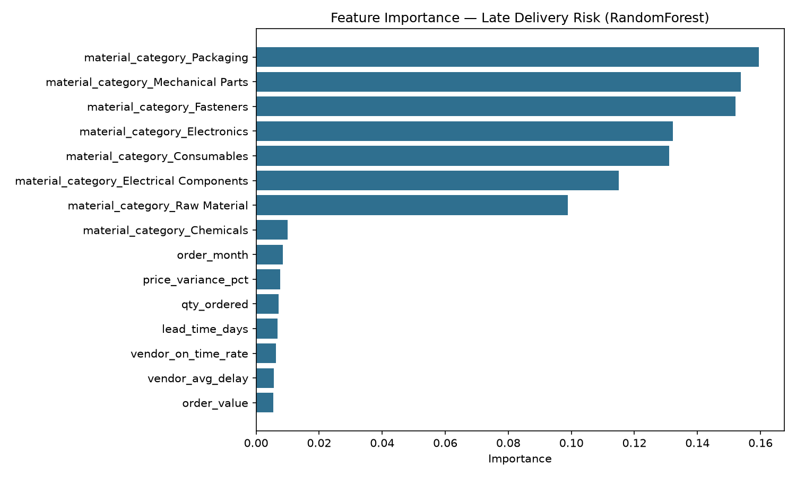
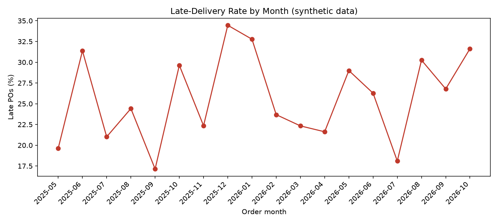

# Supplier Delivery Risk Scoring

**Predict which purchase orders will arrive late — before they are late — so
buyers can chase, expedite, or dual-source in time.**

A late delivery in supply chain is never just "a few days late". It stops a
production line, forces expensive spot buys, and breaks customer promises.
This project scores every purchase order (PO) for late-delivery risk and
ranks vendors on a scorecard, so a planner can see *who* is risky, *which*
orders need attention, and *why* — in one dashboard.

> **All data in this repo is synthetic.** Vendors, dates, quantities and
> prices were invented with a random generator (`src/generate_data.py`).
> No real employer data is used anywhere.

## Architecture

```
synthetic CSVs ──▶ SQLite (demo DB) ──▶ features ──▶ RandomForest ──▶ Streamlit dashboard
  data/*.csv       data/supplier.db      vendor history,        models/risk_model.joblib
  (generate_data)  (load_to_db)          lead time, order value
                                     material category, month
```

MySQL DDL for the same tables lives in `schema.sql`, so the SQL work is
visible even though the runnable demo uses SQLite (stdlib only, no server).

## Tech stack

| Layer | Tools |
|---|---|
| Language | Python 3.10+ |
| Data | pandas, numpy |
| Database | SQLite (demo) + MySQL-compatible DDL in `schema.sql` |
| ML | scikit-learn `RandomForestClassifier` (no XGBoost / LightGBM / TensorFlow) |
| Dashboard | Streamlit, matplotlib |
| Tests | pytest |

## Dataset (synthetic)

Generated with `src/generate_data.py` (seed 42, reproducible):

| File | Rows | Contents |
|---|---|---|
| `data/vendors.csv` | 30 | Vendor id, name, city, material category, underlying reliability |
| `data/purchase_orders.csv` | 2,000 | PO id, vendor, category, order / promised / actual dates, lead time, qty, unit price, order value, price variance, delay days, `is_late` |
| `data/deliveries.csv` | 2,000 | One delivery per PO: promised vs actual date, qty delivered |
| `data/quality_inspections.csv` | 2,000 | Sampled inspection per PO: qty inspected / rejected, rejection % |

- Period: 18 months, May 2025 – Oct 2026.
- Late definition: `delay_days > 3` (actual date more than 3 days after promised date).
- Late rate: **25.9%** of POs (517 / 2,000).
- Delay drivers built into the generator: vendor reliability, long lead times,
  large order values, and Dec/Jan seasonality — the model has to rediscover
  these from the data.

## How to run

```bash
python3 -m venv .venv
source .venv/bin/activate          # Windows: .venv\Scripts\activate
pip install -r requirements.txt

python src/generate_data.py       # create data/*.csv
python src/load_to_db.py          # load CSVs into data/supplier.db + views
python src/train.py               # train model, write results/metrics.json
streamlit run app.py              # open the dashboard
```

The dashboard also works from the CSVs alone: if the `.db` or the trained
model is missing it falls back to a transparent vendor-history heuristic and
tells you to run the pipeline above.

## Model

- **Target:** `is_late` = 1 when a PO arrives more than 3 days late.
- **Model:** `RandomForestClassifier` (200 trees, `class_weight="balanced_subsample"`),
  wrapped in a scikit-learn `Pipeline` with one-hot encoding of material category.
- **Features:** vendor past on-time rate, vendor average delay, lead time,
  order value, quantity, price variance, material category, order month.
  Vendor-history features are computed from the **train split only**, so no
  information leaks into the test set.
- **Split:** 80/20 stratified train/test (1,600 / 400 POs).
- **Risk bands** from predicted probability: High ≥ 0.60, Medium ≥ 0.35, Low < 0.35.
- **Saved to:** `models/risk_model.joblib` (gitignored — regenerate with `python src/train.py`).

### Results (actual run, 11 Nov 2026 — see `results/metrics.json`)

| Metric | Value |
|---|---|
| Precision | **0.517** |
| Recall | **0.291** |
| F1 | **0.373** |
| ROC-AUC | **0.774** |
| Test set | 400 POs (103 late) |
| Confusion matrix | TN 269, FP 28, FN 73, TP 30 |

Reading the numbers honestly: ROC-AUC 0.774 means the model ranks risky POs
clearly better than chance, and when it flags a PO as late it is right about
half the time — but recall 0.29 means it still misses most late deliveries.
Late delivery in this synthetic data is noisy (a Poisson-style delay process),
so a 0.5 decision threshold is conservative. Threshold tuning and richer
features (e.g. vendor performance in the last 90 days, open-order backlog)
are the first improvements to try — see below.

## SQL highlights

`schema.sql` holds MySQL-compatible DDL for all four tables plus three views.
The same views are created in SQLite by `src/load_to_db.py`. Extra queries
live in `sql/`:

- `sql/vendor_scorecard.sql` — the `vendor_scorecard` view: per-vendor
  on-time %, average delay days, late %, rejection %, average order value.
- `sql/at_risk_pos.sql` — late POs, worst delay first, with each vendor's
  overall on-time % for context.
- `sql/monthly_trend_and_quality.sql` — late-delivery rate by month, plus the
  10 vendors with the highest rejection % (min. 20 POs).

```sql
-- vendor_scorecard (excerpt)
SELECT v.vendor_id, v.vendor_name,
       ROUND(100.0 * SUM(CASE WHEN p.delay_days <= 3 THEN 1 ELSE 0 END)
             / COUNT(p.po_id), 2) AS on_time_pct,
       ROUND(AVG(p.delay_days), 2) AS avg_delay_days,
       ROUND(AVG(q.rejection_pct), 2) AS avg_rejection_pct
FROM vendors v
LEFT JOIN purchase_orders p ON p.vendor_id = v.vendor_id
LEFT JOIN quality_inspections q ON q.po_id = p.po_id
GROUP BY v.vendor_id, v.vendor_name;
```

## Dashboard

`streamlit run app.py` gives you:

- **KPI cards** — total POs, late POs, average delay, high-risk POs (all respond to the filters).
- **Vendor scorecard** — every vendor ranked by late %, with on-time %, average delay, rejection % and high-risk PO count.
- **Late-delivery trend chart** — late % by order month.
- **Late rate by material category** — bar chart.
- **At-risk POs list** — high-risk orders sorted by predicted probability.
- **Vendor detail** — pick a vendor and see its full PO history.
- **Actionable recommendations** — escalate / monitor / quality-review / no action,
  driven by each vendor's late % and rejection %.
- Filters for vendor, material category and risk band.

## Screenshots





(Charts are generated by `src/train.py`. Run the app for the live dashboard.)

## Project structure

```
├── app.py                    # Streamlit dashboard
├── schema.sql                # MySQL-compatible DDL + views
├── requirements.txt
├── LICENSE                   # MIT
├── src/
│   ├── generate_data.py      # synthetic data generator (seed 42)
│   ├── load_to_db.py         # CSVs -> SQLite + views
│   └── train.py              # train/test split, RandomForest, metrics, charts
├── sql/                      # vendor_scorecard, at-risk POs, trend/quality queries
├── data/                     # generated CSVs (+ supplier.db, gitignored)
├── models/                   # risk_model.joblib (gitignored)
├── results/metrics.json      # model metrics from the last training run
├── docs/                     # feature_importance.png, late_delivery_trend.png
└── tests/test_smoke.py       # pytest smoke tests
```

## Future improvements

- Tune the decision threshold (or use precision-recall trade-off) to lift
  recall — catching more late POs matters more than avoiding false alarms here.
- Add recency-weighted vendor features (last-90-days on-time rate) and open-order backlog.
- Add a "what-if" simulator: change a promised date / split an order and see the risk change.
- Track model performance over time and retrain monthly as new POs arrive.
- Add an email/alert hook for POs that cross into High risk.

## Author

**Rishu Yadav** — M.Tech CSE–AI, NSUT. SAP MM end-user (supply chain) at
Compass, 7 months. Skills: Python, MySQL. Targeting SAP ABAP / Python / AI /
Data roles in Delhi NCR (0–3 yr experience).
